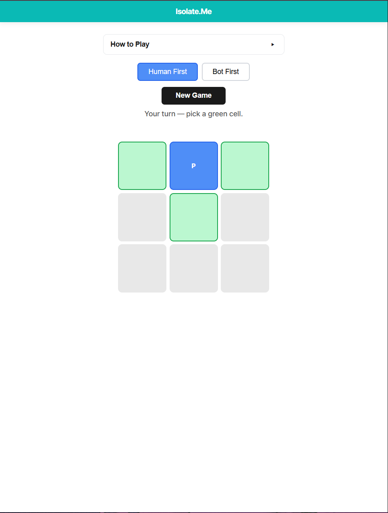

# Isolation Game

🎮 **Live Demo:** [isolate-me.vercel.app](https://isolate-me.vercel.app/)

A web-based implementation of the mathematical strategy board game **Isolation**, built with React and Vite. Features a custom game engine powered by the Minimax algorithm with Alpha-Beta pruning.

---

## Preview



---

## Rules

The game is played on a **3x3 grid** with a single shared token:

1. **Start:** The token starts at position **1** (top-center). The starting tile is burned immediately.
2. **Turns:** Players take turns moving the token one step orthogonally (**up, down, left, right**).
3. **Burning Tiles:** Every tile vacated by the token becomes permanently blocked.
4. **Endgame:** The first player with no legal moves left on their turn loses.

---

## Features & Implementation

- **Minimax Decision Engine:** Explores game states to calculate optimal moves for the computer opponent.
- **Alpha-Beta Pruning:** Cuts off redundant branches in the search tree to minimize compute time.
- **Depth-Weighted Scoring:** Prioritizes faster victories and delays loss scenarios based on distance to terminal state.
- **Separation of Concerns:** Core game and search logic (`src/utils/minimax.js`) is decoupled from React UI components.

---

## Tech Stack

- **Frontend:** React, Vite
- **Styling:** CSS (Grid, Flexbox)
- **Core Logic:** JavaScript (ES6 Modules)
- **Tooling:** Oxlint, Git

---

## Project Structure

```text
isolate-me/
├── index.html
├── package.json
├── docs/
│   └── screenshot.png
└── src/
    ├── main.jsx
    ├── App.jsx
    ├── index.css
    ├── components/
    │   ├── Header.jsx
    │   ├── Rules.jsx
    │   ├── Board.jsx
    │   └── Game.jsx
    └── utils/
        └── minimax.js
```
